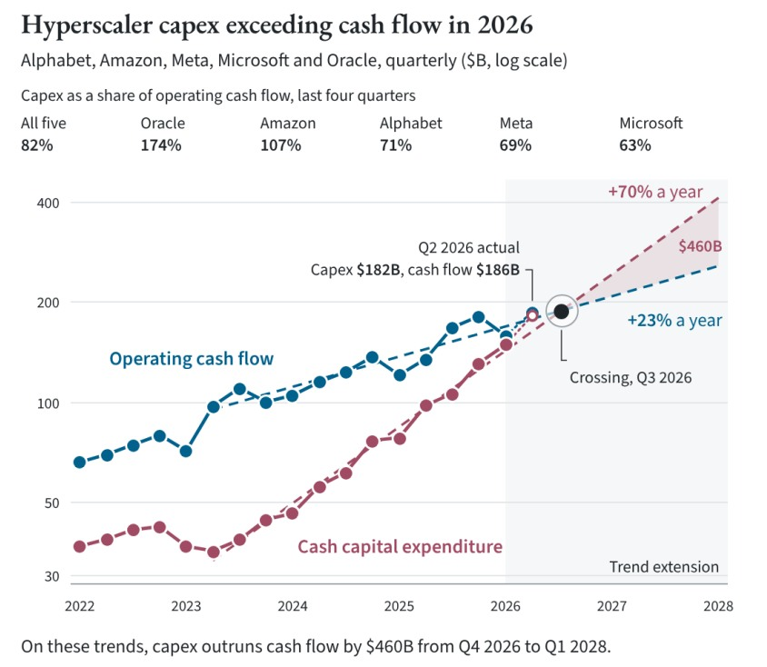
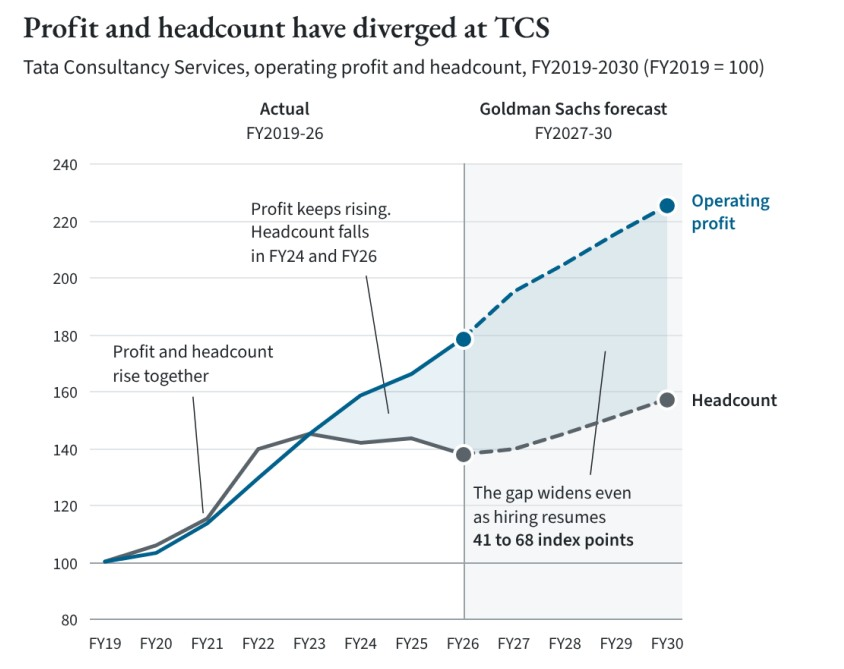
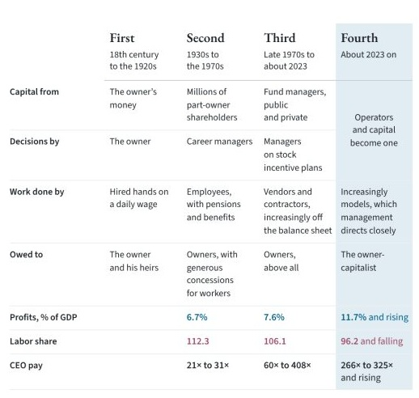

## 先把三个问题分开

《The Commanding Heights》是一份关于 AI 价值归属的长报告。它接受智能继续进步、建设规模继续扩大这两个前提，却怀疑发明者、出资者和最后获利的人，会不会是同一批人。

读它时，我一直保留三个问题：**谁创造价值？谁获得收益？谁最终决定收益如何分配？** 模型能力、用户入口、支付通道、企业流程与国家许可，分别回答了这些问题的一部分。

这套框架有启发性。它把我们从模型榜单和收入增长中拉出来，要求追踪能力怎样真正变成经济活动。它也包含大量强预测：哪些国家会留下真正的主权，谁会失去工作，企业会缩成什么形状，财富最后归谁。下面会把这些预测与已观察到的材料分开。

本文依据英文原作，页码对应 145 页 PDF。数据与关键来源核对截至 **2026 年 11 月 8 日**；这不是对报告全部 153 条注释的完整事实认证。

## 一、模型工厂与智能经济，是两个层次

作者把模型设计、训练、评估、托管和推理服务统称为 **Genesis**。可以把它理解为智能的“出厂环节”。

今天的收入，主要来自少数已经学会把模型装进工作流程的早期使用者。作者用铁路作类比：最初的机车替矿山运煤，随后开放的铁路网络使此前不存在的交易变得可行。真正大的变化，可能发生在技术走出早期封闭用途之后。原文 p.28–33。

据此，模型收入只是智能经济的一部分。更便宜的智能可能催生更多服务、交易和组织方式，而其中的收益未必全部留给供应模型的人。



这里的 *loss leader* 是一种通过其他环节变现的商业策略，不能直接翻成“所有模型都永远免费”。作者明确承认，部分部署与行业整合服务可能形成盈利几十年的业务；他怀疑的是它们覆盖全球经济的速度与规模。原文 p.33。

铁路类比也有边界。轨道依附于地理位置，软件可能更容易切换。两者都需要巨额投入，不足以证明它们会有同一种利润分布。

## 二、AI 成功，某些资本仍可能失败

通常，新增投资回报下降，会让企业减少建设。作者认为 AI 有两股力量可能延缓这个过程。

一股来自竞争。云厂商不只评估新集群自身的回报，也在保护搜索、广告、云计算等既有利润池。停止投入，可能意味着把更大的未来选择权交给对手。原文 p.34–36。

另一股来自国家战略。当前沿能力具有军事、网络攻防和情报价值，继续训练的理由可能从商业回报切换为战略能力。

这解释了一个看似矛盾的组合：**技术取得巨大成功，与某批投资者永久损失资本，可以同时发生。** 对单家企业合理的防御性投资，合计起来也可能导致行业过量建设。

<figure>
  
  <figcaption>原文 p.42。五家公司的季度现金资本开支与经营现金流，单位十亿美元、对数纵轴。460B 是特定窗口的趋势累计差额，不是已经发生的年度亏损。</figcaption>
</figure>

必须分清几个量：固定能力的推理价格、使用量加权 token 价格、GPU 租金、前沿训练成本和公司的实际利润。它们不是同一条曲线。

一个极简关系是：

> 利润 ≈（每个成功任务的价格 − 交付成本）× 成功任务量 − 训练与固定投入。

所以单位价格下降，既不能独自证明利润下降，也不能独自证明需求增长会补足投入。还要知道成本、任务量、差异化与资本更新的速度。

原文 p.52–53 进一步讨论同周期信用风险：AI 支出同时支撑借款人还款、抵押品价值、接盘者购买力和融资方放贷能力。共同需求下降时，这些支持可能一起变弱。拿回一座数据中心，不等于能找到有钱接手的客户。资产以后仍有用，也不消除原债权人在强制出售时的永久损失。

这是一种风险机制，不意味着所有相关债券必然违约，或作者已经证明相关性一定趋近于 1。

## 三、前沿的商业价值与主权价值会分化吗

原文提出三个智能层级。这是理解整篇文章最不能读丢的限定。



| 层级 | 作者的描述 | 需要继续问的问题 |
|---|---|---|
| 商品化智能 | “足够好”的能力广泛可得，价格受替代品约束 | 谁能更便宜、更可靠地交付？ |
| 商业前沿 | 在高价值任务上领先，仍能收取溢价 | 领先值多少钱，保持多久？ |
| 主权前沿 | 为国家战略保留，可能不向一般市场出售 | 谁能接触，谁有权决定用途？ |

作者把中国低价开放权重模型视为美国商业溢价的外部约束：即使知识产权保护完美，只要存在足够好的独立替代品，商业定价仍会承压。原文 p.55–77。

他的推演是：国家逐渐成为长期客户、融资保障者和最后治理者。具体工具可以是采购、许可、基础设施支持、股权或黄金股，并不要求企业形式上全部变成国有。

这还形成一个财政循环：前沿能力扩散，在下游创造收益；国家从整个经济中动员一部分资源，再维持商业上无法自持的主权前沿。原文 p.69、110、138–139。

要分开三件事：**保护战略能力、保护某家公司、保护现有股东。** 它们可能得到完全不同的结果。

作者关于“只有中美能维持真正主权”、美国将压低国债收益率、实验室接受特定国家控制形式的判断，都还属于政治情景。战略重要性不能自动证明财政空间、法律路径与政治支持一定存在。

## 四、模型份额与美元通道的收益可以分开

第四部分讨论“新美元”，即稳定币及其钱包、分发和结算关系。作者设想，即便全球大量工作由中国模型完成，交付界面、公司架构和收付款仍可能经过美国商业与美元体系。



把这条链拆开，会更容易检验：

**能力供给 → 用户关系与授权 → 计价与支付 → 余额留存 → 储备配置与收入分配。**

其中至少有四个不同的量：交易次数、交易金额、常驻美元余额和最终储备资产。AI 使用量增加，不能直接推出美债需求同幅增加；发行人的储备利息，也不能与钱包的手续费混成一笔收入。

我在交互版放了一个教学模型：同样一万亿美元的年交易额，资金平均停留几天，会形成截然不同的余额。它用假设参数解释存量与流量，**不是市场规模或收益预测**。

作者还偏好无需同幅增加资本投入、却能随名义交易额收费的持久通道。这个通胀优势仍有条件：费率、需求、竞争和维护投入都要允许拥有者保有真实购买力。名义收入增长并不自动等于真实利润增长。原文 p.89–90。

## 五、劳动冲击如何穿过国家与制度

原文中的 Ravi 和 Malena 是情景叙事：人先被 AI 增强，随后在积累足够流程与反馈后被替代。它们展示一种机制，不能作为已经发生的个案证据。

作者预期，富国后台的离岸服务岗位可能率先承压。对发展中经济体，这同时涉及服务出口、国内就业和移民机会：如果原有工作减少，而目的国又收紧移民，发展阶梯上的两个出口会一起变窄。原文 p.92–100。

他也没有把所有中美之外的国家归为同一种输家。新加坡等国家，即使没有自己的前沿实验室，仍可能凭数字基础设施、语言、商业环境与吸收能力获取收益。**生产最强模型与吸收经济收益，是两种能力。**

<figure>
  
  <figcaption>原文 p.94，FY2019=100。FY2027–30 为高盛预测，不能当成已经实现的数据。年度人数下降与利润增长不足以单独识别 AI 因果贡献。</figcaption>
</figure>

原文 p.103–104 还把“能完成任务”与“有权对结果负责”分开。审计签字、职业许可、责任承担，可能继续需要被法律认可的人或机构。



这类保护可能更偏向资历较深的人，而让初级入口收窄。但牌照保护某些责任节点，不等于所有美国知识岗位都安全。

还要留意第二层分化：作者说第一幕 K 形经济分开了所有者与劳动收入者，第二幕将进一步分开所有者。旧资产可能被绕过、被稀释或不断要求追加资本；拥有资产本身并非免疫。

与此同时，智能服务降价可能与稀缺教育、住房、安全和隐私涨价共存。作者因此推演了私人会员服务承接公共保障的情景。这个推演值得研究，但它与社会动乱、资本外逃一样，不能仅凭技术暴露度就认定必然发生。

## 六、什么才算真正的制高点



原文最实用的区分，是**暂时瓶颈与持久控制权**。

一座建好却无法接电的数据中心，可能暂时把利润让给供电者。但新供给、现场发电、上游约束或另一种替代路线，都可能使利润再次移动。眼前短缺解释今天的价格，不能单独解释十年后的支配力。原文 p.108–110。

我把作者的检验整理为五个问题：

1. **稀缺从哪里来？** 是长期权利，还是几个月的能力领先或供应短缺？
2. **实际能控制什么？** 接口、付款关系、客户授权、数据权与定价权，分别属于谁？
3. **次优路线总成本多高？** 把寻找、迁移、重新授权、核验与风险成本一起计算。
4. **增长是否增强位置？** 更多活动带来排他反馈与网络，还是只增加成本和补贴？
5. **谁能重新分配收益？** 国家、监管者、用户组织与上游供应商，还有哪些索取权？

数据也要这样拆。历史数据可能只是一次性燃料；持续拥有真实工作流和反馈，是另一种资产。不能笼统地用“有数据”代替对排他性与持续性的研究。

AI 还可能拆掉旧收费站。作者举了一个有用的例子：银行存款的低息优势，部分来自客户没有时间不断找更高收益的账户；个人智能体可能降低这种寻找与迁移的摩擦。原文 p.108–109。

## 七、企业的变化关乎四种权利

原文借科斯讨论企业边界：市场交易有描述、谈判、衡量和核验成本，内部组织也有协调成本。技术改变两边的成本，就可能改变哪些工作放在企业内部。

但作者的预期不只是“人数减少”。他描述了四种制度安排，分别重新组合出资、决策、执行和收益。

| 作者分期 | 出资与决策 | 主要执行者与分配关系 |
|---|---|---|
| 18 世纪至 1920 年代 | 业主出资，也作决策 | 雇工；主要向业主与继承人负责 |
| 1930–1970 年代 | 股权分散，职业经理人决策 | 员工；所有者获益，也给予工人较多福利 |
| 1970 年代末至约 2023 | 资本约束并以股票激励管理层 | 供应商与承包商；优先向所有者负责 |
| 约 2023 起，包含未来预测 | 操盘者与资本融合 | 越来越多由模型执行；业主资本家获取收益 |

这是作者的历史概括，不是各种企业形式整齐替代的已证实规律。原文 p.114–123。



“像资本一样”有两个关键词：报酬与治理。少数关键操盘者不仅要求更高工资，还可能要求利润分成与决策权。

不过，人才收购总价、多年合同和单年 CEO 薪酬，量纲不同。交易也可能包含技术、许可、客户和团队，不能把全部价格当作一个人的生产率。

<figure>
  
  <figcaption>原文 p.121。利润/GDP 与劳动份额为各期可用数据平均值，CEO 薪酬为区间。劳动份额是指数，96.2 不是 96.2%。</figcaption>
</figure>

人数减少也不必意味着资产范围收缩。作者甚至设想实验室购买企业，把真实运营变成强化学习环境。少数操盘者的组织与更大范围的资产所有权，可以同时存在。但合作、授权还是收购更好，仍需比较数据权、持续反馈、责任与整合成本。

司法辖区也是这套组织模型的一部分。原文讨论英语、商业标准、法律可预期性，以及企业对薪酬治理和仲裁制度的选择。私人服务扩张与强国家也未必互斥：最终授权仍可能属于主权者。原文 p.132–139。这些制度愿景，尤其“只有两套技术栈、其他国家不能平衡”的断言，仍需要单独检验。

## 八、最后谈的是授权，而不只是持仓

作者同时质疑两种惯性：把上一时代的收费站当作永久优势，以及把这一时代的发明本身当作持久制高点。

但他也承认，既有企业可能重建位置。原文 p.142 对 Alphabet 的再投资和 Hearst 转向 Fitch 都留下了空间。因此，“所有旧企业注定衰败”并非忠实读法。



结合原注 153，这个要求更具体：指数往往在制高点已被认可后才加大配置；风投通常持发明企业的少数股；传统收购基金借旧现金流融资，并依赖有限期限内退出。作者认为，新机会可能要求改变管理人的授权、控制范围、经营能力和持有期。

这仍不是经过验证的收益策略。方向判断、买入价格、融资、稀释和执行风险，是不同问题；“尚未被定价”也只是作者的判断。

## 哪些证据需要收紧

重新核对后，我保留了主线，但对以下材料加了限定。

**斯坦福的 19%。** 2026 年 8 月 12 日版本可以确认这个数字：AI 暴露职业中 22–25 岁群体的就业，低于按较少暴露同龄群体趋势推算的水平。主要表现为少招新人。研究者同时明确说，尚无全经济范围广泛替代的证据，这些结果是描述性信号，而非 AI 因果效应估计。教育控制、既有趋势和样本代表性也会影响解读。[原研究](https://digitaleconomy.stanford.edu/publication/canaries-in-the-coal-mine-six-facts-about-the-recent-employment-effects-of-artificial-intelligence/)

**TCS 的 7.5%。** 对应卢比计价、剔除特殊项目的营业利润：从 621,650 增至 668,380，单位为百万卢比。它不是美元增速，也不是利润率提高 7.5 个百分点。官方后续披露，2026 年 6 月末员工数又回升至 593,798；年度下降不能直接外推为持续单向裁员。[原报表 PDF p.10](https://www.tcs.com/content/dam/tcs/investor-relations/financial-statements/2025-26/q4/IND%20AS/Press%20Release%20-%20INR.pdf)、[后续披露](https://www.tcs.com/who-we-are/newsroom/press-release/tcs-financial-results-q1-fy-2027)

**资本开支趋势。** Epoch 的 70% 与 23% 是外推拟合，现金开支也不全等于 AI 开支。报告重绘增加了 Q2 2026 实际 182B/186B，但当前所引来源仅列到 Q1 的实际值，新增点来源尚未独立确认。这不等于证明该点错误。[数据与方法](https://epoch.ai/data-insights/hyperscaler-capex-vs-cash-flow)

**巴菲特报纸案例。** 344M 是 2012 年股东信所述过去十五个月的收购金额；2020 年 140M 出售涉及另一资产组合，并排除部分房地产和设备。持有期经营现金流等也未纳入。不能只算两数之比，就称完整投资亏损约 60%；附带贷款也不能直接加作卖报收入。[2012 年报](https://berkshirehathaway.com/2012ar/2012ar.pdf)、[2020 年交易公告](https://investors.lee.net/node/14856)

**GDP 与福利。** 原文 p.102 把 GDP 概括为付费交易，过于简单。GDP 衡量当期生产，也估算部分非市场产出；资产重估通常不进入 GDP，并非统计失灵。免费 AI 的消费者收益与分配确需补充指标，但不能因此认定 GDP 完全看不见 AI 的产出和效率。[BEA 核算说明](https://www.bea.gov/help/faq/488)

**从稀缺到集中。** 稀缺不按定义推出所有权集中。利润集中与消费者生活改善也可能并存。国家介入、知识岗位受保护、广泛繁荣不太可能等结论，都需要各自的制度、就业与分配证据。

未逐项外部核验的材料，还包括中美家庭资产跨国口径、所有宏观增长归因、人才交易完整条款和部分政治轶事。本文没有把它们标为“全部核实”。

## 我最后保留的判断

我最愿意带走的方法，是沿着 **能力 → 活动 → 收益 → 控制权** 去看一项技术，而不急着把任何一层当作永久赢家。

作者提出了有用的问题，但历史类比、相关走势图和制度必然性的修辞，不能共同替代对终局的证明。每一座推论的桥，都需要自己的证据。

结尾还应与悲观的主线并读：



这没有撤回作者对权力集中的预期，却提醒我们：不能把整篇文章改写成所有模型无利润、所有旧企业败亡、所有普通人变穷的定论。

继续阅读时，可以带着三个反问：用户是否能低成本绕行？收益是否通过价格、新岗位或制度安排扩散？如果模型继续进步，而作者预期的集中并未发生，我们应当修改哪一条判断？

[进入交互版，查看全部 24 段双语精读、8 张原图和教学模型 →](explore/)

## 来源与修订

- **原作**：Will Manidis & Joe Roberts，*The Commanding Heights*，2026-10-29，[官方网站](https://commanding-heights.com/)、[145 页 PDF](https://commanding-heights.com/commanding-heights.pdf)。
- **2026-11-08**：完成主要论点回读与关键来源抽核，补充证据限定、四种企业安排和结尾的开放性。
- **2026-11-09**：整理为公开精读文章与交互版。

英文节选与图表归原作者及其标明的来源所有；中文为本次校译。作者主张、数据、未来情景和独立分析分别标注。所引用图表保留原页码与口径提醒，完整出处见原报告相应脚注。
